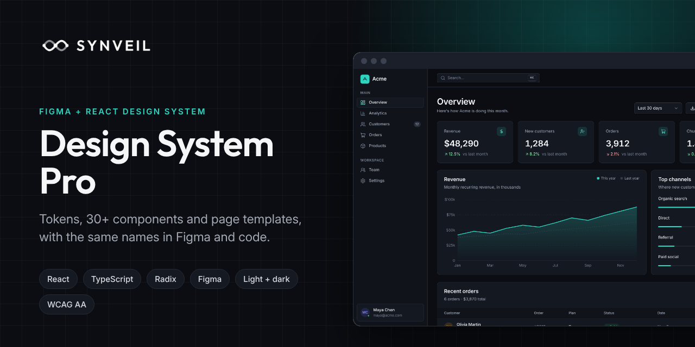
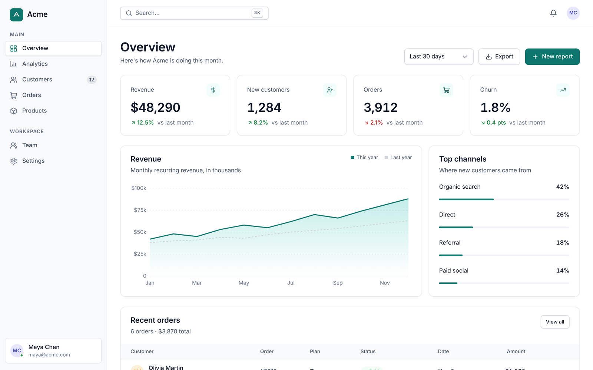
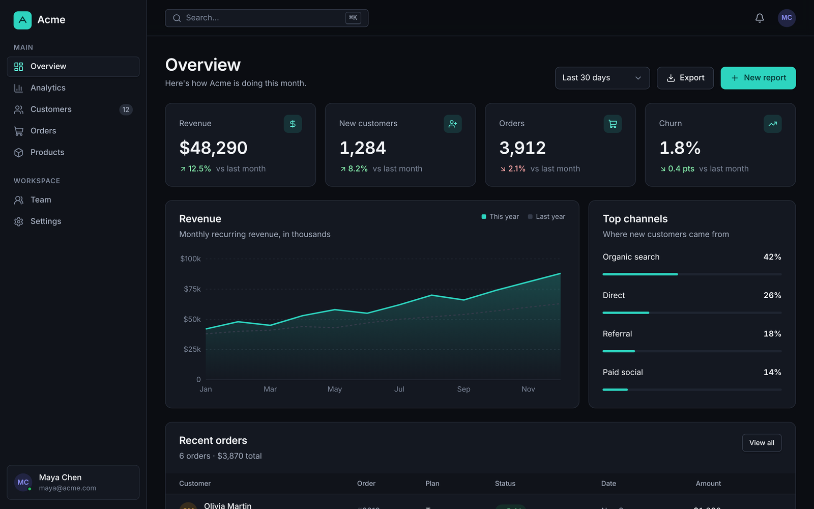
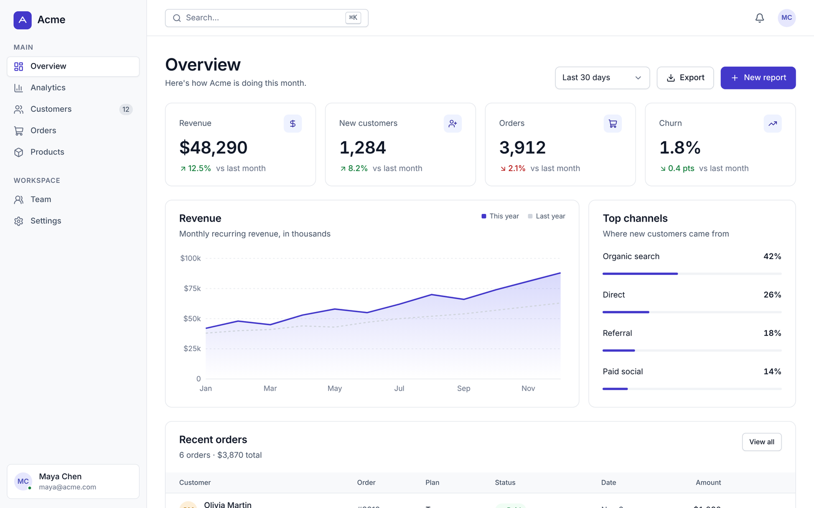
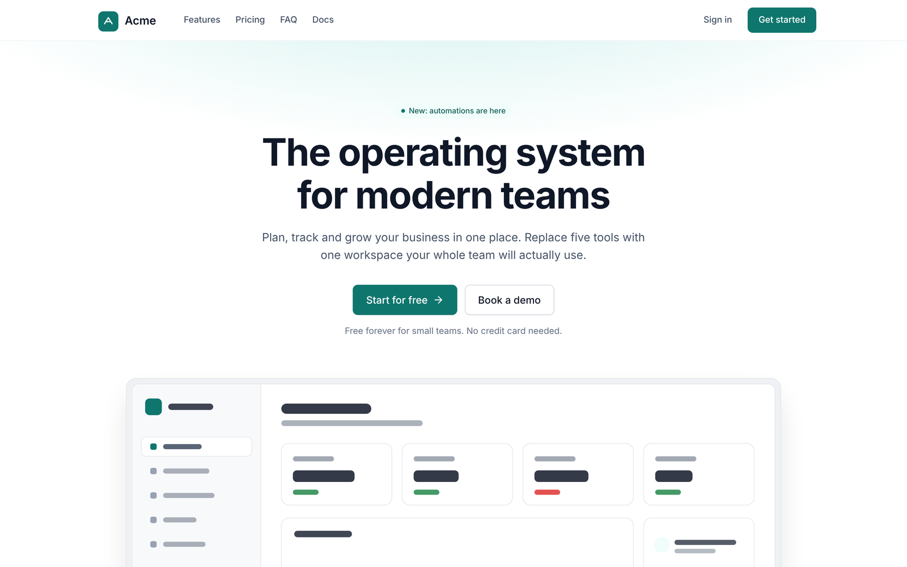
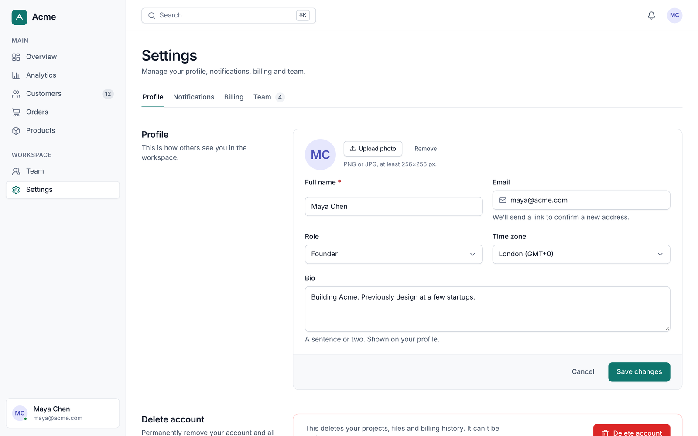
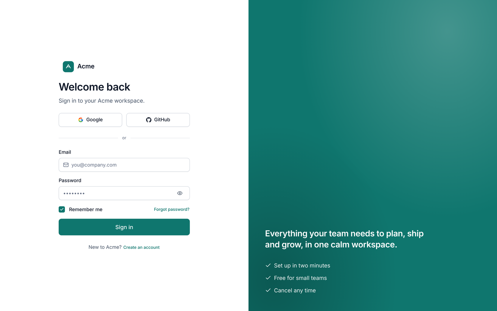
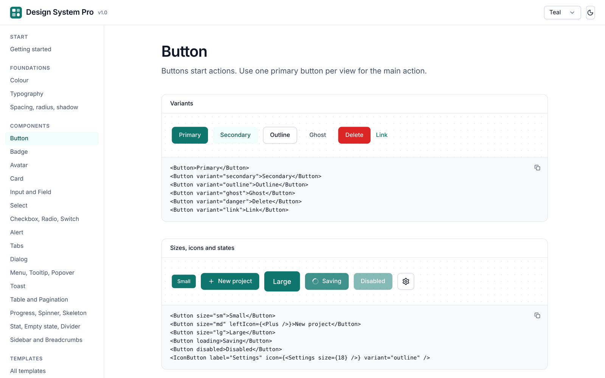
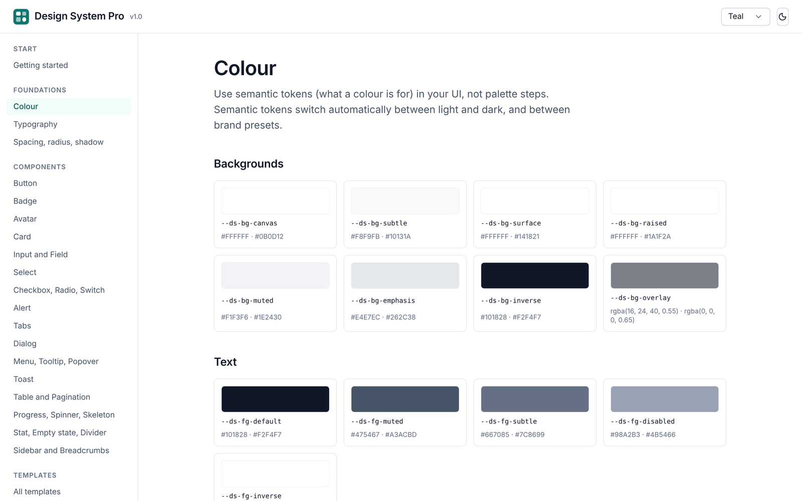

# Design System Pro

**A design system in Figma and in React, with the same names in both.** Tokens, 30+ components and four page templates, so design and code stay in sync.

**$249, one-time** · [**Buy on Whop →**](https://whop.com/synveil/design-system-pro/) · [All Synveil kits](https://synveil.whop.site/)

> This repo is the public page for Design System Pro. The library and the Figma file are delivered when you buy. They aren't in this repo.

## What's inside

| | |
|---|---|
| **Tokens** | Colour, typography (14 text styles), spacing, radius, shadow, motion and z-index, as CSS variables, TypeScript and DTCG JSON, all generated from one script |
| **Components** | 30+ React components on Radix: Button, IconButton, Badge, Avatar, Card, Field, Input, Textarea, Select, Checkbox, Radio, Switch, Alert, Tabs, Dialog, ConfirmDialog, DropdownMenu, Tooltip, Popover, Toast, Table, Pagination, Progress, Spinner, Skeleton, Stat, EmptyState, Breadcrumbs, Sidebar, NavItem, Divider, Kbd |
| **Themes** | Light and dark, plus four brand presets: teal, indigo, blue and orange |
| **Templates** | Dashboard, Settings, Marketing landing page, Sign in |
| **Figma file** | Variables, text and effect styles, components and the four templates, with matching names |
| **Docs** | A live documentation page that runs offline, plus six guides (getting started, components, theming, templates, accessibility, Figma) |

Every token pair passes WCAG AA contrast, checked by an included script. Menus, dialogs, selects and tabs work with the keyboard and screen readers. No CSS framework is required, so it sits alongside Tailwind, CSS Modules or anything else.

## Screenshots

These are the templates and docs from the kit, rendered in a browser.

**Dashboard template, light, dark and the indigo brand preset**



| Dark theme | Indigo brand |
|---|---|
|  |  |
| **Marketing template** | **Settings template** |
|  |  |
| **Sign-in template** | **Live docs: Button** |
|  |  |

<details>
<summary>Live docs: colour tokens</summary>


</details>

## Quick look at the code

```tsx
import "design-system-pro/styles.css";
import { Button, Toaster, TooltipProvider, toast } from "design-system-pro";

export default function App() {
  return (
    <TooltipProvider>
      <Button onClick={() => toast.success("It works")}>Click me</Button>
      <Toaster />
    </TooltipProvider>
  );
}
```

## How you get it

1. Buy on [Whop](https://whop.com/synveil/design-system-pro/). Access is instant.
2. Download the zip and open `docs.html` in your browser to see everything running.
3. Install it into your app with `npm install --install-links ../design-system-pro`, or copy the source into your project.
4. Duplicate the Figma file from the link on the product page.

## License

One payment covers unlimited products of your own and products you build for clients. You can change, extend and rebrand everything. You can't resell or publish the kit itself as a UI kit or library, or put its source in a public repository or package registry. The full license comes in the download.

Also in [Synveil Complete](https://whop.com/synveil/synveil-complete/), the bundle of all five Synveil kits.
